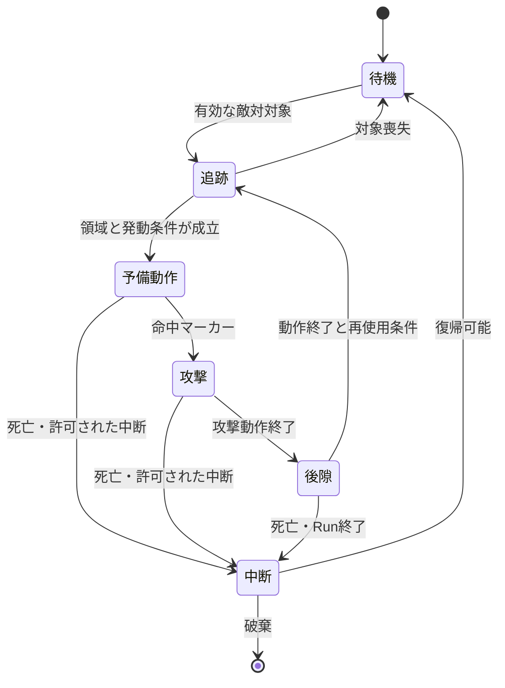

# 領域センサーで行動を選ぶ大型NPC — Roblox実装案

**Status: Draft（実装案・未採用・未実装）**
**作成日: 2026-10-06**
**requires_code: true** — 領域検出、行動選択、アニメーション、命中判定を接続するコードが必要。

## 何を作るか

大型NPCの周囲に「正面」「左右」「足元」の検知領域を置き、敵対対象が入った領域に対応する動作を出す。追いかける、腕を振り下ろす、踏みつける、見回す、といった動きを組み合わせ、状況を判断しているように見せる。

核は **「対象へ近づく移動 ＋ 領域ごとのアニメーション発動」**。方向別の行動をビヘイビアツリーや角度・内積の分岐で書かず、領域の位置と大きさで調整する。移動経路、敵対関係、動作中の排他、命中の確定は別に必要になる。

本案は汎用的な制御方式の候補であり、ゴーレムの外見、新しいボスの正体、出現マップや報酬を確定しない。初回は検証用の通常敵NPCとして扱う。

## 参照投稿から受け取った内容

出典はユーザー提供の投稿要約。投稿URL・投稿者・元動画・エンジン版は未確認。次は要約内の説明であり、Robloxでの検証結果ではない。

- 巨大なゴーレムがプレイヤーに近づき、相手の位置に応じて自然に攻撃や見回しを行う。
- 移動は `AI Move To`。複数のBox/Sphereへ敵対派閥タグのPawnが重なると、対応するアニメーションモンタージュを再生する。
- 投稿ではビヘイビアツリー、内積などの位置関係計算、Timer、Event Tickを使わないと説明されている。
- 領域の配置だけで調整でき、重み付きランダムを足すと動作に変化が出る。
- 大量のゾンビではなく、エリアに1〜2体の中ボス向けと説明されている。Robloxでの許容数や性能は未測定。

借りるのは「見た目の判断を空間配置で作る」という考え方。元モデル、モーション、台詞、動画の演出はそのまま流用しない。

## Robloxへの対応

| 投稿の要素 | Roblox版の候補 | 注意 |
| --- | --- | --- |
| AI Move To | `Humanoid:MoveTo()` | 障害物を避ける経路探索は別。必要ならPathfindingを追加 |
| Box/SphereのOverlap | `GetPartsInPart()`、`GetPartBoundsInBox()`、`GetPartBoundsInRadius()` | 検知Partの接触イベントだけに依存しない案を推奨 |
| 敵対派閥のタグ | `CollectionService`による対象登録＋Server管理の派閥属性／敵対関係表 | タグの有無だけで全対象を敵と決めない |
| Animation Montage | `Animator:LoadAnimation()`で得た`AnimationTrack` | モンタージュの各機能を一対一で置き換えるAPIではない |
| 動作中の攻撃タイミング | `GetMarkerReachedSignal()` | アニメーションと実際の命中判定を分離 |
| 緑のワイヤーフレーム | デバッグ用の領域表示 | 開発中だけ。ゲーム内の常設HUDにはしない |

`Humanoid:MoveTo()`には未到達時の約8秒のタイムアウトがある。追跡対象が動く場合は目標を更新し、経路に詰まった場合は停止・再試行・経路探索を別途扱う。[Humanoid公式API](https://create.roblox.com/docs/reference/engine/classes/Humanoid)

## 検知方式：イベント版とクエリ版

### 推奨する試作：低頻度の空間クエリ

Serverが有効な大型NPCだけを、仮に毎秒5〜10回の頻度で評価する。頻度は計測後に決める。毎フレームの全NPC・全領域検査はしない。

- 空間クエリで領域内の対象を集め、Model単位に重複を除く。
- 初期状態から領域内にいる相手、動作中に侵入した相手、領域内に留まる相手も次の評価で拾える。
- 検知結果から「今、動作を開始できるか」だけを評価する。動作中は新しい攻撃を割り込ませない。

**この版は投稿の「Timer/Tickなし」を再現しない。** Robloxでの取りこぼしを減らすための実装上の補正。ビヘイビアツリーと方向の内積判定は引き続き不要だが、領域の座標変換や移動処理まで計算不要になるわけではない。

Box/Radiusクエリは対象Partの境界箱で重なりを調べるため、細い形状や球状の領域では見た目と差が出得る。形状との重なりが必要なら`GetPartsInPart()`を選ぶ。`OverlapParams`で対象集合や除外対象を絞る。[WorldRoot公式API](https://create.roblox.com/docs/reference/engine/classes/WorldRoot)

### 投稿に近い試作：接触イベント

`Touched`で候補を登録し、`TouchEnded`で外す。複数の身体Partが触れても同じCharacterとして扱う。初期重なり、動作終了後、対象の消滅時には候補を再確認する。

`Touched`は物理移動による接触を扱うため、CFrameで直接重ねる移動だけを前提にしない。`CanTouch`と衝突グループの設定も確認する。接触を1回受けて終わる実装では、領域内に留まる相手へ次の攻撃を出せない場合がある。[BasePart公式API](https://create.roblox.com/docs/reference/engine/classes/BasePart)

完全なイベント版を選ぶ場合も、動作終了イベントで再評価し、Cooldown満了の一度きりの予約処理を設けるか、再侵入まで再発動しないルールを明示する。発動条件を維持したまま無期限に待つ状態を作らない。

## 領域の作り方

初回は4〜5個で十分。寸法はモデルとアニメーションの到達範囲に合わせてStudioで調整し、正式値は定めない。

| 領域 | 行動候補 | 見せたい判断 |
| --- | --- | --- |
| 正面・腕の届く範囲 | 腕を振り下ろす | 正面へ踏み込む相手を狙う |
| 左側／右側 | 横薙ぎ、対応側へ向き直る | 側面へ回り込まれた反応 |
| 足元の近距離 | 踏みつける | 密着している相手を退ける |
| 少し外側 | 見回し、追跡継続 | 攻撃距離に届かない相手を探す |

領域はRootに対するローカル配置で定義する。必要なら透明・非衝突のPartをRootへ固定して編集する。移動するリグへ固定したセンサーは`Massless`とし、センサーだけをAnchoredにしてリグ全体を固定しない。クエリ版は`CanTouch=false`でもよい。フィルターや`CanQuery`を含めて実機で確認する。

初回の領域はRoot基準で固定し、腕のアニメーションで「判断領域」まで振り回さない。攻撃の命中形状は別に、動作に合わせて評価する。領域を広げると発動しやすくなるが、腕の届く距離まで伸びた扱いにはしない。

## どの行動を選ぶか

1. 有効領域にいるCharacterを重複除去する。アクセサリや道具だけの侵入は採用しない。
2. 生存、同一Run・マップ、敵対関係、対象の有効性をServerで確認する。壁越しに攻撃を選ばせない領域は遮蔽も検査する。
3. 現在追跡している対象を優先する。別対象へ切り替えるのは、追跡対象が無効・離脱したとき等に限定する。
4. 動作中・Cooldown中の候補を除外する。
5. 最も高い優先度の候補から1動作だけ選ぶ。同点は固定順で決める。調整後に、同じ優先度の候補間だけ重み付き抽選を追加できる。

「足元」と「正面」の重なりには、例えば足元の優先度を高くする。接触イベントが先に届いた順では決めない。複数プレイヤーが別々の領域にいても、1体のNPCは同時に1動作だけ実行する。

重み付き抽選は候補が揃った評価時に1回だけ行う。身体Partごと、センサーごとに抽選すると、Partの多いアバターが選ばれやすくなる。初回は乱数なしで配置と優先度を検証する。

## 移動とアニメーション

追跡は行動選択から分ける。初回は平坦で障害物の少ない検証場所を使い、`Humanoid`付きの仮リグで試す。スキンメッシュとBoneだけの既存モデルに、そのまま`MoveTo()`を呼べるとは仮定しない。

- 待機・追跡中だけ移動先を更新する。対象喪失時は移動要求を止める。
- 攻撃を選んだら追跡移動を止め、予備動作へ移る。命中直前まで対象を追って向きを変え続けない。
- 予備動作を始めるまでに向きを決め、踏みつけ・振り下ろし中は原則固定する。滑りやRoot Motion相当の移動は別途検証する。
- 歩行と攻撃のAnimation Priority、ブレンド、フェード時間を調整する。足元の滑りや攻撃時の歩行残りを確認する。

NPCの`Animator`はServerで生成し、Serverからアニメーションを読み込んで再生する。プレイヤーCharacterとNPCで複製の扱いが異なるため、NPCの攻撃を各Clientが個別に選ばない。[Animator公式API](https://create.roblox.com/docs/reference/engine/classes/Animator)



見回しは非攻撃の独立動作として同じ排他を使う。状態名と行動キーは説明用で、正式なSystem IDではない。

## 発動判定と命中判定を分ける

**領域へ入ったことは、ダメージを受けたことではない。** 検知領域は動作を選ぶ入口。ダメージは予備動作を見て避けられるタイミングに置く。

- アニメーションの命中フレームに`Hit`等のマーカーを置き、Server側の`GetMarkerReachedSignal()`で受ける。
- その時点の腕・足・衝撃地点に対応する別の命中形状で、対象を取り直す。
- 同じ攻撃1回の中ではCharacterごとに1Hit。複数Part・複数領域・重複コールバックで多重ダメージにしない。
- 開始時に狙った相手が避けていれば当たらない。別の敵対対象が命中形状にいれば当たり得る。
- 最初は命中時点の1回の判定で試す。速い薙ぎ払いを連続形状で拾う方式は別の試作項目とする。

マーカーは動作と処理の同期点に使える。[AnimationTrack公式API](https://create.roblox.com/docs/reference/engine/classes/AnimationTrack)

各動作に世代番号または実行トークンを付ける。中断後に旧マーカー、遅延処理、終了コールバックが届いても、新しい攻撃の状態を変えない。マーカー欠落・Animationロード失敗・強制停止では攻撃判定を出さず、ログを残して排他を解く。ループ設定ミス等への監視期限も必要なら一度きりで予約する。

## Server / ClientとEffectの境界

| 項目 | 担当・契約 |
| --- | --- |
| 対象集合・敵対派閥・行動・Cooldown | Serverで保持・確定。タグや派閥属性の正式名称は未定 |
| 移動と攻撃アニメーション開始 | Serverで制御。Clientは攻撃開始の認可を持たない |
| 命中・HP・Knockback・Stun | Serverで確定。既存戦闘処理への接続口はStudioで確認が必要 |
| 足音・地響き・揺れ・予兆 | Clientで表現。攻撃トークンと位置を受け、距離・画面揺れ設定に応じて提示 |
| 検知領域のデバッグ表示 | 開発時のみ有効化。選択領域・対象・抑止理由を記録 |
| 終了・破棄 | 死亡、対象消滅、マップ破棄、Run終了で接続・予約・候補を解放 |

物理移動するNPCはネットワーク所有権も確認する。Server所有にする案は、対象Assemblyが設定可能かを確認して試す。所有権を固定しただけでプレイヤーの移動報告を完全に信頼できるようになるわけではない。[BasePart公式API](https://create.roblox.com/docs/reference/engine/classes/BasePart)

Effectは[共通Effectと保存境界](effect-components.md)の既定規則に従う。

- **Trigger**: 敵対対象が行動領域内にいる評価。
- **Condition**: 対象有効、実行可能な状態、再使用条件、必要なら遮蔽検証。
- **Effect**: 動作の`StateChange`、命中時の`Damage`、押し退ける`Move`、必要な場合だけ個別定義したStunの`StateChange`。
- **対象・範囲**: 選択対象は行動選択の基準。効果対象は命中時点の形状にいる敵対Character。共有NPC状態はRun内、HP等は対象ごとに保持。
- **保存境界・終了**: 行動RuntimeとCooldownは同一マップ中。攻撃状態は一時、終了・中断・死亡・マップ離脱・Run終了のいずれかで破棄。HPへの即時Damageは攻撃終了時に巻き戻さない。
- **重ね掛け**: 1攻撃1対象1Hitは本攻撃の命中仕様。別攻撃は別の即時イベント。持続状態は既定の非加算1件と競合保留に従う。
- **Feedback**: 攻撃前の身体動作、命中地点の音・反応、後隙を見せる。判定成功と世界の意味を混同しない。

通常敵NPCへの適用を試しても、Anomaly EntityやPlayer Anomalyの型・ライフサイクルを統合しない。PvPやダメージ下限を、この制御方式独自のルールで上書きしない。

## 調整データと処理の骨格

調整データには領域形状・Rootからの配置・対象フィルター・候補動作・優先度・重み・Animation参照・命中形状・再使用条件・動作中断条件を持たせる。サイズ、Cooldown、威力、アニメーションIDの具体値は未定。

```text
低頻度の評価:
  無効なNPC / Run終了なら停止
  対象候補を確認して追跡先を維持・更新
  動作中なら新しい行動選択はしない
  各領域を検査 → Characterへ正規化・重複除去
  敵対性・生存・同一Run・遮蔽を検査
  再使用可能な候補から優先度順に1動作を選ぶ
  実行トークンを更新 → 移動停止 → Animation開始

命中マーカー:
  実行トークンと動作状態が有効か確認
  命中形状を検査 → 対象ごとの重複Hitを除外
  既存戦闘ルールでDamage / Moveを解決

動作終了 / 中断:
  対応するトークンだけを終了
  命中受付と接続を解放 → 必要ならCooldownへ
  次の評価で領域内の相手を取り直す
```

初回はServer側のNPC個別Controllerと共通の評価スケジューラで十分。格納先、Module名、Remote名を現行Studio構造へ確認せず確定しない。新しい外部ライブラリは前提にしない。

## Anomaly Dungeonへの適用範囲

[現在の実装状況](current-implementation.md)はStudioの棚卸しであり、本案の領域制御・敵対派閥・複数攻撃アニメーションが実装済みという根拠ではない。本稿ではStudioの実構造との比較を行っていない。

[Mad Stomper](../anomalies/mad-stomper.md)には移動・ストンプ・鎮静のプロトタイプがあるが、通常のHP撃破ボスではなく通過を妨げる環境アノマリーである。`GIANT`との同一性は[判断013](../decisions/013-mad-stomper-giant-identity.md)で採用済み。本案の追跡・振り下ろしをMad Stomperの確定挙動へ追加しない。

将来Mad Stomperへ領域判定の技術だけを使うなら、通過妨害・Heal鎮静・報酬・固有Interactionとの適合を別途判断する。現行2マップRunの実装範囲は変更しない。

## 最小試作と合格条件

1. 検証用NPC1体、仮リグ、正面・足元の2領域、2動作を用意する。既存の[アニメーション制作工程](../production/animation-pipeline.md)に従い、Publish済みAnimationとマーカーを確認する。
2. ダメージなしで領域表示と行動ログを確認する。配置変更だけで行動の境界を調整できることを見る。
3. Serverの命中判定を追加し、予備動作中に外へ避ければ被弾しないことを確認する。
4. 左右領域と、必要なら見回しを加える。1体→2体、1Client→複数Clientの順で計測する。

確認項目:

- 初期重なり、留まり続け、複数領域の重なりでも動作が停止・連打・二重再生しない。
- 複数プレイヤー、身体Partの多いアバター、アクセサリ、死亡・再生成・切断で対象を誤認しない。
- 壁越しに発動・命中しない。移動先の詰まりを放置しない。
- 攻撃中断、Animation失敗、マーカー欠落、Run終了後に旧処理からダメージが出ない。
- 全Clientが同じ攻撃を見て、HPはServerで一度だけ更新される。
- センサーを非衝突にしても移動やリグの接地を壊さない。
- NPC数×領域数×評価頻度、クエリ時間、通信、物理・アニメーション負荷を計測する。100体には向かない、1〜2体なら安全、とは実測前に断定しない。

**未確定**: 適用NPC、対象選定と敵対派閥、センサー寸法、追跡更新周期、Pathfindingの必要性、中断・Cooldown、アニメーション／攻撃形状、ダメージ・Stun・Knockback、スマートフォンと複数Clientでの負荷。
